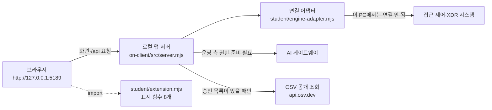

# 케셰브 학생용 실행 설명서와 시스템 구성도 (21단계)

이 문서는 13~20단계에서 만든 보안 Agent 앱 **케셰브**를 다른 사람이 같은 순서로 켜고, 끄고, 다시 켤 수 있게 적은 설명서입니다.
"직접 확인함"이라고 적은 것은 이 문서를 쓰면서 실제로 실행해 본 것이고, "미확인"이라고 적은 것은 실행하지 않았거나 실행할 수 없었던 것입니다. 제공 문서는 덮어쓰지 않았고, 이 파일은 학생이 새로 쓴 문서입니다.

## 1. 목적과 기능

케셰브는 회사 직원이 자기 로그인 상태, 업무 앱 접속 결과, 최근 접속 기록과 보안 경보를 보는 보안 앱입니다. 브라우저 화면 위에 학생이 만든 표시 함수 8개가 올라가 있습니다.

| 단계 | 학생이 만든 함수(`on-client/student/extension.mjs`) | 보여 주는 것 |
|---|---|---|
| 13 | `renderIdentity` | 로그인 사용자·기기·세션과 상태 |
| 14 | `renderDecision` | 업무 앱 접근 판정(허용·거부·추가 확인·확인 불가)과 이유·시각 |
| 15 | `renderEvents` | 접속 기록·XDR 경보 목록, 필터 3개, 기록별 상세 |
| 16 | `renderStatus` | 기기·세션 빈 상태와 실패, 알림, 도움정보 복사, 미지원 조치 안내 |
| 17 | `renderAiConnection` | AI 연결 점검 결과(사건 설명과 구분) |
| 18 | `renderExplanation` | 근거에 연결된 AI 사건 설명(참고용) |
| 19 | `renderAction` | 조치 제안·사람 확인·서버 접수(ACK)·실제 효과 확인 구분 |
| 20 | `renderVulnerabilities` | 설치 패키지의 정확한 버전과 알려진 취약점(OSV) 조회 결과 |

이 프로젝트에는 별개의 앱이 두 개 들어 있습니다.

- **자료실(1~12단계)**: 저장소 최상위 폴더의 `api/`, `src/`, `public/`. Vercel에 배포되는 앱입니다. 공개 주소: https://choi-bujang-secret-vault-wine.vercel.app
- **케셰브(13~22단계)**: `on-client/` 폴더. 내 PC에서만 켜는 로컬 앱입니다. 이 문서는 케셰브를 설명합니다.

## 2. 지원 환경과 버전

| 항목 | 값 | 확인 |
|---|---|---|
| 운영체제 | Windows 11 Pro 10.0.26100 | 직접 확인함 |
| Node.js | v24.21.0 (수업 기준은 24.19.0, `on-client/package.json`의 `engines`) | v24.21.0에서 실행해 확인함. 24.19.0 정확 버전은 미확인 |
| npm | 11.19.0 | 버전만 확인함. 외부 npm 의존성은 없음 |
| 브라우저 | Claude 데스크톱 앱 안의 내장 브라우저(PC 브라우저가 아님) | 이 환경에서 화면을 확인함. 버전은 미확인 |
| 다른 운영체제·브라우저 | macOS, Linux, Windows 10, 다른 브라우저 | 지원 여부 확인하지 않음 |

## 3. 폴더 구조

```text
C:\Users\user\choi-bujang-secret-vault\      ← Git 저장소 최상위(프로젝트 폴더)
├─ README.md                                   ← 저장소 설명(1~12단계 + 13~22단계 안내)
├─ docs\STUDENT_RUNBOOK.md                     ← 이 문서
├─ api\ src\ public\ ...                       ← 자료실(1~12단계, Vercel)
└─ on-client\                                  ← 케셰브 앱 폴더(제공 시작 틀 0.2.11)
   ├─ package.json                             ← scripts: start, demo, check
   ├─ .env.example                             ← 비밀 없는 설정 견본
   ├─ src\server.mjs                           ← 로컬 앱 서버(제공 코드)
   ├─ src\engine.mjs                           ← 연결 엔진 불러오기·예제 엔진(제공 코드)
   ├─ src\ai\ src\connection\ src\actions\     ← AI 연결·계정 연결·조치(제공 코드)
   ├─ src\vulnerabilities\                     ← OSV 조회(제공 코드)
   ├─ public\index.html, app.js, style.css     ← 브라우저 화면(제공 코드, 수정하지 않음)
   ├─ student\extension.mjs                    ← 학생이 만든 표시 함수 8개
   ├─ student\engine-adapter.mjs               ← 기존 시스템 연결 어댑터(시작 틀 그대로)
   ├─ tools\start-alekov.ps1                   ← 실행 도구(제공)
   └─ docs\                                    ← 제공 문서
```

## 4. 시스템 구성도

### 4-1. 글 구성도 (ASCII)

```text
[브라우저]  http://127.0.0.1:5189/
    │  화면 파일 받기, /api/... 요청 (이 PC 안에서만)
    ▼
[로컬 앱 서버]  on-client/src/server.mjs  (127.0.0.1:5189 에서만 듣는다)
    │
    ├─ /api/me /api/apps /api/devices /api/sessions /api/events /api/access
    │      → [연결 어댑터] student/engine-adapter.mjs
    │           → [접근 제어·XDR 시스템(SDP 호스트)]   ← 이 PC에서는 연결 안 됨(ENGINE_NOT_CONNECTED)
    │
    ├─ /api/ai/check /api/ai/explain
    │      → [AI 게이트웨이(수업용)]                  ← 운영 측 권한이 준비돼야 연결됨(ON_AI_PROVISIONING_PENDING)
    │
    ├─ /api/actions/prepare /execute /result
    │      → [접근 제어·XDR 시스템의 조치 경로]        ← 연결되지 않음(지원 조치 없음)
    │
    ├─ /api/vulnerabilities
    │      → [OSV 공개 조회] https://api.osv.dev/v1/querybatch  ← 승인된 패키지 목록이 비어 있으면 조회하지 않음
    │
    └─ /api/diagnostics   → 비밀 없는 점검 결과(요청 ID·구성요소·버전·엔진 상태)

[브라우저 안의 화면 코드]  public/app.js
    └─ import('/student/extension.mjs') → createStudentView() → 표시 함수 8개를 부른다
```

### 4-2. Mermaid 구성도



### 4-3. 구성 요소 표

| 구성 요소 | 실제 파일·주소 | 역할 | 이 PC에서의 상태 |
|---|---|---|---|
| 브라우저 | http://127.0.0.1:5189/ | 화면 표시, 서버에 요청 | 직접 확인함 |
| 로컬 앱 서버 | `on-client/src/server.mjs` | 화면 파일·`/api/*` 제공, 자기 PC(127.0.0.1)에서만 접속 | 직접 확인함 |
| 학생 표시 함수 | `on-client/student/extension.mjs` | 서버가 준 자료를 글자로 표시 | 직접 확인함 |
| 연결 어댑터 | `on-client/student/engine-adapter.mjs` | 접근 제어·XDR 시스템과 이어 주는 자리 | 기본은 `disconnected` |
| 접근 제어·XDR 시스템 | (담당자가 안내할 때만 연결) | 실제 로그인·기기·판정·기록 | 연결하지 않음. 미확인 |
| AI 게이트웨이 | (운영 측이 권한을 준비한 뒤 연결) | 앱 안 AI 연결 점검·사건 설명 | 연결하지 않음. 미확인 |
| OSV | https://api.osv.dev/v1/querybatch | 알려진 취약점 조회 | 승인 패키지 목록이 비어 있어 조회하지 않음 |

## 5. 실행 순서

### 5-1. 필요한 프로그램

- Node.js 22~24(수업 기준 24.19.0). `node -v`로 확인합니다.
- Git(저장소를 받을 때만 필요).
- 외부 npm 패키지 설치는 필요하지 않습니다(`npm install` 불필요).

### 5-2. PowerShell을 여는 위치

1. 파일 탐색기에서 `C:\Users\user\choi-bujang-secret-vault\on-client` 폴더를 엽니다. (**저장소 최상위가 아니라 그 안의 `on-client`** 입니다.)
2. 주소 표시줄에 `powershell`을 입력하고 Enter를 누릅니다. 그 폴더에서 PowerShell 창이 열립니다.

### 5-3. 실행 명령

같은 서버를 켜는 방법이 세 가지 있습니다. 모두 `on-client` 폴더에서 실행합니다.

| 방법 | 명령 | 결과 | 확인 |
|---|---|---|---|
| 기본 실행 | `npm start` (`package.json`에서 `node src/server.mjs`를 실행) | 실제 시스템에 연결되지 않은 상태로 켜짐 | `node src/server.mjs`로 직접 확인함. `npm start` 글자 그대로는 미확인 |
| 예제 실행 | `npm run demo` (`node src/server.mjs --demo`) | 예제 자료로 화면이 채워짐. 실제 연결이 아님 | `node src/server.mjs --demo`로 직접 확인함 |
| 제공 실행 도구 | `powershell -NoProfile -ExecutionPolicy Bypass -File .\tools\start-alekov.ps1` | Node 버전·포트를 확인한 뒤 서버를 켬 | **미확인**(이번 작업에서 실행하지 않았음) |

### 5-4. 정상 시작 신호

- 기본 실행: 터미널에 `케셰브 연결 확인: http://127.0.0.1:5189` 한 줄이 나옵니다. (직접 확인함)
- 예제 실행: `케셰브 예제: http://127.0.0.1:5189` 한 줄이 나옵니다. (직접 확인함)
- 브라우저에서 http://127.0.0.1:5189/ 를 열면 위쪽 상태 표시와 「보호 현황」 화면이 보입니다. 기본 실행에서 서버는 HTTP 200으로 응답했습니다. (직접 확인함)
- 기본 실행에서 `/api/me`는 `ENGINE_NOT_CONNECTED`(연결 없음)를 돌려줍니다. 이것이 이 PC의 정상 상태이며 연결 성공이 아닙니다. (직접 확인함)

### 5-5. 종료와 재실행

- **종료**: 서버를 켠 PowerShell 창에서 `Ctrl+C`를 누릅니다. 브라우저에서 주소가 더 이상 열리지 않으면 종료된 것입니다.
- **재실행**: 같은 `on-client` 폴더에서 5-3의 명령을 다시 실행합니다. 서버를 켜고 끄는 것은 내 파일을 바꾸지 않습니다.
- **포트가 이미 쓰이는 경우**: 제공 실행 도구는 `-Port 5190`을 지원한다고 안내되어 있습니다. 미확인.

## 6. 화면에서 확인한 기능

예제 실행(`--demo`)으로 직접 확인한 것입니다. 예제 자료는 실제 연결의 결과가 아닙니다.

| 단계 | 확인한 내용 | 결과 |
|---|---|---|
| 13 | 학생 칸에 사용자·기기·세션 표시, 다시 불러오기로 값 교체, 서버를 끈 뒤 다시 불러오면 연결 실패가 보이고 옛 사용자 이름이 사라짐 | 확인함 |
| 14 | 업무 앱 「학습 자료실」에서 접속 요청을 누르면 허용(allow)·이유·시각 표시 | 확인함(거부·추가 확인은 가짜 값으로만) |
| 15 | 기록 1건 표시, 상세를 열고 다시 불러오면 상세가 닫힘 | 확인함(필터 여러 건은 가짜 값으로만) |
| 16 | 도움정보를 불러온 뒤 「도움정보 복사」로 여섯 개 값만 복사, 복사할 때 요청이 나가지 않음 | 확인함 |
| 17 | 「현재 API 연결 점검」을 누르면 권한 준비 중(`ON_AI_PROVISIONING_PENDING`) 표시 | 확인함(연결 성공은 미확인) |
| 18 | 기록을 고르기 전에 「보안 기록에서 기록을 먼저 고르세요」 표시 | 확인함(실제 설명 생성은 미확인) |
| 19 | 「아직 미실행(idle)」과 조치 준비 버튼이 없는 것이 정상이라는 안내 표시 | 확인함(다른 상태는 가짜 값으로만) |
| 20 | 「설치 패키지 조회」를 누르면 조회 준비 미완료(`not_configured`) 표시 | 확인함(실제 조회는 미확인) |

## 7. 구현한 함수와 제공 코드의 경계

| 구분 | 파일 | 내가 고쳤나 |
|---|---|---|
| 학생이 만든 것 | `on-client/student/extension.mjs`의 `renderIdentity`~`renderVulnerabilities` 8개 | 고침 |
| 제공 코드 | `on-client/public/app.js`, `public/index.html`, `public/style.css`, `src/` 아래 모든 파일, `tools/` | 고치지 않음 |
| 제공 코드 | `on-client/student/engine-adapter.mjs`(시작 틀 그대로) | 고치지 않음 |
| 제공 문서 | `on-client/docs/` 아래 문서, `on-client/README.md` | 고치지 않음 |
| 1~12단계 자료실 | 저장소 최상위 `api/`, `src/`, `public/` 등 | 이번 단계에서 고치지 않음 |

학생 표시 함수는 서버에 직접 요청하지 않습니다. 제공 화면(`public/app.js`)이 자료를 모아서 함수에 넘기고, 함수는 `document.createElement`와 `textContent`로 요소를 만들어 돌려줍니다. `innerHTML` 등 HTML 문자열 삽입은 쓰지 않았습니다.

## 8. 오류가 났을 때 확인 순서

| 증상 | 확인 순서 |
|---|---|
| 서버가 안 켜짐 | ① `node -v`로 22~24인지 확인 ② PowerShell이 `on-client` 폴더인지 확인(`package.json`이 보여야 함) ③ 터미널의 첫 오류 줄을 확인 |
| 포트가 이미 사용 중 | 5189를 쓰는 다른 프로그램을 끄거나, 제공 실행 도구의 `-Port 5190`을 쓴다(미확인) |
| 화면은 뜨는데 모든 칸이 「연결 없음」 | 기본 실행이면 정상입니다(`ENGINE_NOT_CONNECTED`). 예제 화면이 필요하면 `npm run demo` |
| 학생 칸에 「학생 구현 대기」 또는 「student/extension.mjs를 불러오지 못했습니다」 | `npm run check`로 `student/extension.mjs` 문법을 확인 → 브라우저 새로고침 |
| 학생 칸에 「학생 구현 ◯◯ 실행 중 오류가 발생했습니다」 | 그 함수에서 예외가 난 것입니다. 제공 화면은 계속 동작합니다. 함수 이름의 코드를 확인 |
| AI 연결 점검이 「권한 준비 중(`ON_AI_PROVISIONING_PENDING`)」 | 운영 측 준비가 끝나야 합니다. 담당자에게 확인을 요청합니다. 학생 코드를 고치지 않습니다 |
| 설치 패키지 조회가 「조회 준비 미완료(`not_configured`)」 | 조회 대상은 운영자가 준비합니다. 설정을 임의로 바꾸지 않습니다 |
| 강사에게 상태를 보여 줘야 함 | 「보호 현황」의 도움정보 불러오기 → 「도움정보 복사」(비밀값은 들어 있지 않음) |

## 9. 미확인 기능 (확인했다고 쓰지 않은 것)

- 제공 실행 도구 `tools\start-alekov.ps1`의 실행과 `-Port`, `-Background` 옵션.
- Node.js 24.19.0 정확 버전에서의 실행.
- 실제 접근 제어·XDR 시스템(SDP) 연결, 실제 로그인·기기·판정 값, 실제 기록·경보.
- 앱 안 AI 연결 성공(`test`/`verified`)과 실제 사건 설명 생성.
- 실제 보안 조치 준비·집행·결과 재조회.
- OSV 실제 조회 결과와 취약점 표시.
- 메뉴·필터·상세 버튼을 키보드(Tab·Enter)로만 조작하는 확인.
- Windows 11 이외 환경, 내장 브라우저 이외의 브라우저.
- ALEPH의 단계별 판정 결과(이 문서에 적지 않으며 ALEPH 화면에서 확인).

## 10. 비밀값 관리

- 이 문서와 저장소에는 키·토큰·비밀번호를 적지 않았습니다. 키가 필요한 연결은 화면의 안내 절차로만 하며 값을 직접 입력하지 않습니다.
- `on-client/.env.example`에는 비밀 없는 설정(포트 `ON_PORT=5189` 등)만 있습니다. 실제 `.env`는 만들지 않았고, 저장소 `.gitignore`가 `.env`를 제외합니다.
