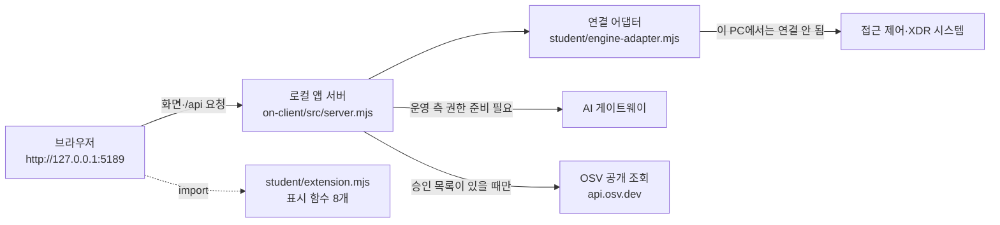

# 케셰브 학생용 실행 설명서와 시스템 구성도 (21단계, 마무리 단계 갱신)

> 마무리 단계에서 `renderStatus`에 요약 카드 4개를, `renderEvents`에 기록별 심각도 배지와 최근 5건 요약을 더했습니다. 내용은 아래 1장 표, 6장, 7-1장에 있고, 확인하지 못한 부분은 9장에 적었습니다.

이 문서는 13~20단계에서 만든 보안 Agent 앱 **케셰브**를 다른 사람이 같은 순서로 켜고, 끄고, 다시 켤 수 있게 적은 설명서입니다.
"직접 확인함"이라고 적은 것은 이 문서를 쓰면서 실제로 실행해 본 것이고, "미확인"이라고 적은 것은 실행하지 않았거나 실행할 수 없었던 것입니다. 제공 문서는 덮어쓰지 않았고, 이 파일은 학생이 새로 쓴 문서입니다.

## 1. 목적과 기능

케셰브는 회사 직원이 자기 로그인 상태, 업무 앱 접속 결과, 최근 접속 기록과 보안 경보를 보는 보안 앱입니다. 브라우저 화면 위에 학생이 만든 표시 함수 8개가 올라가 있습니다.

| 단계 | 학생이 만든 함수(`on-client/student/extension.mjs`) | 보여 주는 것 |
|---|---|---|
| 13 | `renderIdentity` | 로그인 사용자·기기·세션과 상태 |
| 14 | `renderDecision` | 업무 앱 접근 판정(허용·거부·추가 확인·확인 불가)과 이유·시각 |
| 15 | `renderEvents` | 접속 기록·XDR 경보 목록, 필터 3개, 기록별 상세. 마무리 단계에서 기록별 심각도 배지와 최근 5건 요약을 더함 |
| 16 | `renderStatus` | 기기·세션 빈 상태와 실패, 알림, 도움정보 복사, 미지원 조치 안내. 마무리 단계에서 맨 위에 요약 카드 4개(기기·세션·알림·자료 구분)를 더함 |
| 17 | `renderAiConnection` | AI 연결 점검 결과(사건 설명과 구분) |
| 18 | `renderExplanation` | 근거에 연결된 AI 사건 설명(참고용) |
| 19 | `renderAction` | 조치 제안·사람 확인·서버 접수(ACK)·실제 효과 확인 구분 |
| 20 | `renderVulnerabilities` | 설치 패키지의 정확한 버전과 알려진 취약점(OSV) 조회 결과 |

이 프로젝트에는 별개의 앱이 두 개 들어 있습니다.

- **자료실(1~12단계)**: 저장소 최상위 폴더의 `api/`, `src/`, `public/`. Vercel에 배포되는 앱입니다. 공개 주소: https://choi-bujang-secret-vault-wine.vercel.app
- **케셰브(13~22단계)**: `on-client/` 폴더. 내 PC에서만 켜는 로컬 앱입니다. 이 문서는 케셰브를 설명합니다.

## 2. 지원 환경과 버전

| 항목 | 값 | 확인 |
|---|---|---|
| 운영체제 | Windows 11 Pro 10.0.26100 | 직접 확인함 |
| Node.js | v24.21.0 (수업 기준은 24.19.0, `on-client/package.json`의 `engines`) | v24.21.0에서 실행해 확인함. 24.19.0 정확 버전은 미확인 |
| npm | 11.19.0 | 버전만 확인함. 외부 npm 의존성은 없음 |
| 브라우저 | Claude 데스크톱 앱 안의 내장 브라우저(PC 브라우저가 아님) | 이 환경에서 화면을 확인함. 버전은 미확인 |
| 마무리 단계 확인 PC | Windows 11 Home 10.0.26200, Node.js v24.20.0, npm 11.19.0 | 이 PC에서 `npm run check`, `npm run demo`, 화면 표시를 직접 확인함. 위 표의 Pro·v24.21.0은 21단계 작성 때 기록임 |
| 다른 운영체제·브라우저 | macOS, Linux, Windows 10, 다른 브라우저 | 지원 여부 확인하지 않음 |

## 3. 폴더 구조

```text
<프로젝트 폴더>\                            ← Git 저장소 최상위(저장소를 받은 위치. 이름은 choi-bujang-secret-vault)
├─ README.md                                   ← 저장소 설명(1~12단계 + 13~22단계 안내)
├─ docs\STUDENT_RUNBOOK.md                     ← 이 문서
├─ api\ src\ public\ ...                       ← 자료실(1~12단계, Vercel)
└─ on-client\                                  ← 케셰브 앱 폴더(제공 시작 틀 0.2.11)
   ├─ package.json                             ← scripts: start, demo, check
   ├─ .env.example                             ← 비밀 없는 설정 견본
   ├─ src\server.mjs                           ← 로컬 앱 서버(제공 코드)
   ├─ src\engine.mjs                           ← 연결 엔진 불러오기·예제 엔진(제공 코드)
   ├─ src\ai\ src\connection\ src\actions\     ← AI 연결·계정 연결·조치(제공 코드)
   ├─ src\vulnerabilities\                     ← OSV 조회(제공 코드)
   ├─ public\index.html, app.js, style.css     ← 브라우저 화면(제공 코드, 수정하지 않음)
   ├─ student\extension.mjs                    ← 학생이 만든 표시 함수 8개
   ├─ student\engine-adapter.mjs               ← 기존 시스템 연결 어댑터(시작 틀 그대로)
   ├─ student\system-status.mjs                ← CPU·메모리·디스크를 읽는 코드(마무리에서 새로 만듦)
   ├─ tools\start-alekov.ps1                   ← 실행 도구(제공)
   └─ docs\                                    ← 제공 문서
```

## 4. 시스템 구성도

### 4-1. 글 구성도 (ASCII)

```text
[브라우저]  http://127.0.0.1:5189/
    │  화면 파일 받기, /api/... 요청 (이 PC 안에서만)
    ▼
[로컬 앱 서버]  on-client/src/server.mjs  (127.0.0.1:5189 에서만 듣는다)
    │
    ├─ /api/me /api/apps /api/devices /api/sessions /api/events /api/access
    │      → [연결 어댑터] student/engine-adapter.mjs
    │           → [접근 제어·XDR 시스템(SDP 호스트)]   ← 이 PC에서는 연결 안 됨(ENGINE_NOT_CONNECTED)
    │
    ├─ /api/ai/check /api/ai/explain
    │      → [AI 게이트웨이(수업용)]                  ← 운영 측 권한이 준비돼야 연결됨(ON_AI_PROVISIONING_PENDING)
    │
    ├─ /api/actions/prepare /execute /result
    │      → [접근 제어·XDR 시스템의 조치 경로]        ← 연결되지 않음(지원 조치 없음)
    │
    ├─ /api/vulnerabilities
    │      → [OSV 공개 조회] https://api.osv.dev/v1/querybatch  ← 승인된 패키지 목록이 비어 있으면 조회하지 않음
    │
    ├─ /api/system        → 이 PC의 CPU·메모리·디스크를 일반 권한으로 한 번 읽음(마무리에서 추가)
    │
    └─ /api/diagnostics   → 비밀 없는 점검 결과(요청 ID·구성요소·버전·엔진 상태)

[브라우저 안의 화면 코드]  public/app.js
    └─ import('/student/extension.mjs') → createStudentView() → 표시 함수 8개를 부른다
```

### 4-2. Mermaid 구성도



### 4-3. 구성 요소 표

| 구성 요소 | 실제 파일·주소 | 역할 | 이 PC에서의 상태 |
|---|---|---|---|
| 브라우저 | http://127.0.0.1:5189/ | 화면 표시, 서버에 요청 | 직접 확인함 |
| 로컬 앱 서버 | `on-client/src/server.mjs` | 화면 파일·`/api/*` 제공, 자기 PC(127.0.0.1)에서만 접속 | 직접 확인함 |
| 학생 표시 함수 | `on-client/student/extension.mjs` | 서버가 준 자료를 글자로 표시 | 직접 확인함 |
| 연결 어댑터 | `on-client/student/engine-adapter.mjs` | 접근 제어·XDR 시스템과 이어 주는 자리 | 기본은 `disconnected` |
| 접근 제어·XDR 시스템 | (담당자가 안내할 때만 연결) | 실제 로그인·기기·판정·기록 | 연결하지 않음. 미확인 |
| AI 게이트웨이 | (운영 측이 권한을 준비한 뒤 연결) | 앱 안 AI 연결 점검·사건 설명 | 연결하지 않음. 미확인 |
| OSV | https://api.osv.dev/v1/querybatch | 알려진 취약점 조회 | 승인 패키지 목록이 비어 있어 조회하지 않음 |

## 5. 실행 순서

### 5-1. 필요한 프로그램

- Node.js 22~24(수업 기준 24.19.0). `node -v`로 확인합니다.
- Git(저장소를 받을 때만 필요).
- 외부 npm 패키지 설치는 필요하지 않습니다(`npm install` 불필요).

### 5-2. PowerShell을 여는 위치

1. 파일 탐색기에서 저장소를 받은 폴더(`<프로젝트 폴더>`) 안의 `on-client` 폴더를 엽니다. (**저장소 최상위가 아니라 그 안의 `on-client`** 입니다.)
2. 주소 표시줄에 `powershell`을 입력하고 Enter를 누릅니다. 그 폴더에서 PowerShell 창이 열립니다.

### 5-3. 실행 명령

같은 서버를 켜는 방법이 세 가지 있습니다. 모두 `on-client` 폴더에서 실행합니다.

| 방법 | 명령 | 결과 | 확인 |
|---|---|---|---|
| 기본 실행 | `npm start` (`package.json`에서 `node src/server.mjs`를 실행) | 실제 시스템에 연결되지 않은 상태로 켜짐 | `node src/server.mjs`로 직접 확인함. `npm start` 글자 그대로는 미확인 |
| 예제 실행 | `npm run demo` (`node src/server.mjs --demo`) | 예제 자료로 화면이 채워짐. 실제 연결이 아님 | `node src/server.mjs --demo`로 직접 확인함 |
| 제공 실행 도구 | `powershell -NoProfile -ExecutionPolicy Bypass -File .\tools\start-alekov.ps1` | Node 버전·포트를 확인한 뒤 서버를 켬 | **미확인**(이번 작업에서 실행하지 않았음) |

### 5-4. 정상 시작 신호

- 기본 실행: 터미널에 `케셰브 연결 확인: http://127.0.0.1:5189` 한 줄이 나옵니다. (직접 확인함)
- 예제 실행: `케셰브 예제: http://127.0.0.1:5189` 한 줄이 나옵니다. (직접 확인함)
- 브라우저에서 http://127.0.0.1:5189/ 를 열면 위쪽 상태 표시와 「보호 현황」 화면이 보입니다. 기본 실행에서 서버는 HTTP 200으로 응답했습니다. (직접 확인함)
- 기본 실행에서 `/api/me`는 `ENGINE_NOT_CONNECTED`(연결 없음)를 돌려줍니다. 이것이 이 PC의 정상 상태이며 연결 성공이 아닙니다. (직접 확인함)

### 5-5. 종료와 재실행

- **종료**: 서버를 켠 PowerShell 창에서 `Ctrl+C`를 누릅니다. 브라우저에서 주소가 더 이상 열리지 않으면 종료된 것입니다.
- **재실행**: 같은 `on-client` 폴더에서 5-3의 명령을 다시 실행합니다. 서버를 켜고 끄는 것은 내 파일을 바꾸지 않습니다.
- **포트가 이미 쓰이는 경우**: 제공 실행 도구는 `-Port 5190`을 지원한다고 안내되어 있습니다. 미확인.

## 6. 화면에서 확인한 기능

예제 실행(`--demo`)으로 직접 확인한 것입니다. 예제 자료는 실제 연결의 결과가 아닙니다.

| 단계 | 확인한 내용 | 결과 |
|---|---|---|
| 13 | 학생 칸에 사용자·기기·세션 표시, 다시 불러오기로 값 교체, 서버를 끈 뒤 다시 불러오면 연결 실패가 보이고 옛 사용자 이름이 사라짐 | 확인함 |
| 14 | 업무 앱 「학습 자료실」에서 접속 요청을 누르면 허용(allow)·이유·시각 표시 | 확인함(거부·추가 확인은 가짜 값으로만) |
| 15 | 기록 1건 표시, 상세를 열고 다시 불러오면 상세가 닫힘 | 확인함(필터 여러 건은 가짜 값으로만) |
| 16 | 도움정보를 불러온 뒤 「도움정보 복사」로 여섯 개 값만 복사, 복사할 때 요청이 나가지 않음 | 확인함 |
| 17 | 「현재 API 연결 점검」을 누르면 권한 준비 중(`ON_AI_PROVISIONING_PENDING`) 표시 | 확인함(연결 성공은 미확인) |
| 18 | 기록을 고르기 전에 「보안 기록에서 기록을 먼저 고르세요」 표시 | 확인함(실제 설명 생성은 미확인) |
| 19 | 「아직 미실행(idle)」과 조치 준비 버튼이 없는 것이 정상이라는 안내 표시 | 확인함(다른 상태는 가짜 값으로만) |
| 20 | 「설치 패키지 조회」를 누르면 조회 준비 미완료(`not_configured`) 표시 | 확인함(실제 조회는 미확인) |
| 마무리 | 「보호 현황」의 학생 상태 칸 맨 위에 요약 카드 4개: 기기 `? 확인 불가`, 세션 `● 정상`, 알림 `▲ 주의`(2건), 자료 구분 `▲ 주의`(예제 자료) | 확인함(예제 자료에서 위 값이 나옴. 다른 값은 미확인) |
| 마무리 | 「보안 기록」에서 기록 1건에 `심각도: ▲ 주의 (접속 거부)`, 맨 위에 `최근 1건 요약` 표시 | 확인함(화면에서는 예제 기록 1건뿐) |
| 마무리 | 「내 PC 사용량」: CPU `11 %`, 메모리 `13.3 GB / 31.1 GB (42.7 %)`, 디스크 `1042.7 GB 남음 / 전체 1862.0 GB (C:\)`가 잰 시각·단위·출처와 함께 표시됨. 「다시 재기」 뒤 `직전 측정 대비 -7.8%p` 등 추이 표시 | 확인함(내 PC에서 직접 잰 값). PC가 OS로 알려 준 값과 대조: 디스크 남은 공간 1042.7 GB 일치, 메모리 13.3 vs 13.7 GB(몇 초 차이), CPU는 순간 값이라 11 % vs 5 % 차이 |
| 마무리 | 「이 PC의 네트워크·방화벽·Windows 기록」: 어댑터 3개(이더넷 연결됨, 이더넷 2 연결됨·가상 어댑터로 보임, Wi-Fi 연결 끊김), 방화벽 Domain·Private·Public 모두 켜짐(들어오는·나가는 기본 동작은 기본값), System 오류 1·경고 10건, Application 오류 1·경고 4건(최근 24시간)이 잰 시각·출처와 함께 표시됨. `SDP 미연결 — 예제 자료(demo)로 실행 중`이 PC 조회와 따로 표시됨. 「침해나 공격을 탐지한 결과가 아닙니다」 문구 표시됨 | 확인함(내 PC에서 직접 읽은 값, 관리자 권한 없이 읽힘). 방화벽 값은 `Get-NetFirewallProfile`을 직접 실행한 결과와 일치 |
| 마무리 | 읽지 못하는 경우: 가짜 실행기로 관리자 권한 필요·시간 초과·Windows 아님·PowerShell 없음, 기록 한 곳만 권한 없음을 만들면 해당 항목만 `확인 불가`와 이유 코드(`ADMIN_REQUIRED`, `READ_TIMEOUT` 등)가 나오고 CPU 등 나머지는 정상 | 확인함(서버 쪽 읽기 함수만. 실제로 권한 없는 기록을 읽어 본 것은 아님. 화면 표시는 코드로만 확인) |
| 마무리 | 읽지 못하는 경우: 없는 드라이브 `Z:\`로 디스크를 읽게 하면 디스크만 `확인 불가`와 이유 `DISK_READ_FAILED(ENOENT)`가 나오고 CPU·메모리는 정상 | 확인함(서버 쪽 읽기 함수만. 화면 표시는 코드로만 확인) |
| 마무리 | 가짜 기록 6건으로 심각도 배지 확인: 정상, 확인 불가(기기·상태 없음), 주의(XDR 경보·세션 철회). 최근 5건 요약은 6번째 기록을 제외하고, 전부 정상일 때만 `● 정상`, 확인 불가만 있으면 `? 확인 불가`. 요약 카드는 연결·정상 값에서 4개 모두 `● 정상`, 실패·불러오는 중·값 없음에서 모두 `? 확인 불가` | 확인함(가짜 값으로 Node에서 표시 함수를 직접 불러 확인함. 시험 파일은 저장소에 넣지 않음. 실제 화면 확인 아님) |

## 7. 구현한 함수와 제공 코드의 경계

| 구분 | 파일 | 내가 고쳤나 |
|---|---|---|
| 학생이 만든 것 | `on-client/student/extension.mjs`의 `renderIdentity`~`renderVulnerabilities` 8개 | 고침 |
| 제공 코드 | `on-client/public/app.js`, `public/index.html`, `public/style.css`, `src/` 아래 `server.mjs`를 뺀 모든 파일, `tools/` | 고치지 않음 |
| 제공 코드 | `on-client/src/server.mjs` | **마무리 단계에서 5줄 추가**(`/api/system` 경로 추가, 7-4장 참고) |
| 제공 코드 | `on-client/student/engine-adapter.mjs`(시작 틀 그대로) | 고치지 않음 |
| 제공 문서 | `on-client/docs/` 아래 문서, `on-client/README.md` | 고치지 않음 |
| 1~12단계 자료실 | 저장소 최상위 `api/`, `src/`, `public/` 등 | 이번 단계에서 고치지 않음 |

학생 표시 함수는 서버에 직접 요청하지 않습니다. 제공 화면(`public/app.js`)이 자료를 모아서 함수에 넘기고, 함수는 `document.createElement`와 `textContent`로 요소를 만들어 돌려줍니다. `innerHTML` 등 HTML 문자열 삽입은 쓰지 않았습니다.

### 7-1. 마무리 단계에서 더한 표시의 판단 기준

서버는 심각도를 주지 않으므로 아래 값으로 화면 코드가 계산합니다. 기호와 글자를 함께 써서 색만으로 구분하지 않습니다. 확인 불가는 정상으로 세지 않습니다.

| 수준 | 기록 배지 기준 | 요약 카드 기준 |
|---|---|---|
| ▲ 주의 | XDR 경보, 접속 거부(`denied`), 세션 만료·철회, 기기 기준 미충족 중 하나라도 있음 | 기기 `noncompliant`, 세션 `expired`·`revoked`, 알림 1건 이상, 자료가 예제(`demo`) |
| ? 확인 불가 | 주의가 없고 접속·세션·기기 상태 중 하나라도 `unknown`이거나 값이 없음 | 불러오는 중, 실패, 목록 비어 있음, 상태 `unknown`, 연결 없음 |
| ● 정상 | 위 둘에 해당하지 않음 | 모두 정상 상태일 때만(알림 0건, 실제 연결 자료) |

여러 값이 섞이면 가장 나쁜 수준(주의 > 확인 불가 > 정상)으로 보입니다. 최근 요약은 가장 최근 5건(5건보다 적으면 있는 만큼)을 셉니다. 제공 화면은 고치지 않았고 기존 CSS 클래스만 썼습니다. 요약 카드는 제공 화면의 「학생 상태·알림 표시」 칸 안에 있어서 화면 맨 위가 아니라 그 칸의 맨 위에 보입니다.

### 7-2. 제공된 것과 내가 바꾼 것 (마무리 단계)

제공된 「현재 로그인」·「내 기기」·「내 세션」 카드는 다시 만들지 않았습니다. 그 위에 내 표시 함수만 더했습니다.

| 구분 | 내용 | 마무리에서 고쳤나 |
|---|---|---|
| 제공 | 「현재 로그인」·「내 기기」·「내 세션」 카드, 서버와 `/api/*`, 스타일(`public/`, `src/`, `student/engine-adapter.mjs`) | 고치지 않음. 단 `src/server.mjs`에만 5줄 추가(7-4장) |
| 내가 만든 것(13~20단계) | `renderIdentity`, `renderStatus` 등 표시 함수 8개 | 22단계 때 만듦 |
| 내가 바꾼 것(마무리) | `renderStatus` 맨 위 요약 카드 4개, `renderEvents`의 심각도 배지·최근 5건 요약, 「내 PC 사용량」 표시 | 이번에 추가(`student/extension.mjs`) |
| 내가 만든 것(마무리) | CPU·메모리·디스크를 읽는 코드 | 새 파일 `student/system-status.mjs`. 서버에 연결하려고 제공 파일 `src/server.mjs`에 5줄 추가 |

CPU 사용률·메모리 사용량·디스크 남은 공간은 제공 코드에 없습니다(`on-client` 전체를 검색해 확인함). 그래서 중복 구현이 아니라 새로 만들었고, 그 과정에서 **제공 파일 `src/server.mjs`에 5줄만 더했습니다**(import 1줄, `/api/system` 읽기 전용 경로 4줄. 기존 줄은 바꾸지 않았습니다). 실제로 재는 코드는 내 파일 `student/system-status.mjs`에 있습니다. 앱의 「기기」는 보안 기준 충족 여부이며 PC 사용량이 아닙니다.

### 7-4. 내 PC 사용량 (2일차 추가 기능)

| 값 | 읽는 방법(일반 권한, 관리자 권한 불필요) | 단위 | 읽지 못할 때 |
|---|---|---|---|
| CPU 사용률 | Node `os.cpus()`를 250ms 간격으로 두 번 재서 계산 | % | `? 확인 불가` + 이유 코드(`CPU_INFO_UNAVAILABLE` 등) |
| 메모리 사용량 | Node `os.totalmem()` − `os.freemem()` | GB(1GB=1024³바이트), % | `MEMORY_INFO_INVALID` 등 |
| 디스크 남은 공간 | Node `fs.statfs()`로 앱이 있는 드라이브(예: `C:\`)를 읽음 | GB | `DISK_PERMISSION_DENIED`, `DISK_READ_FAILED(ENOENT)` 등 |

- 값마다 **잰 시각(한국 시각)**과 **출처**가 옆에 붙습니다. 이 값은 예시가 아니라 이 PC에서 직접 읽은 값이며, 화면에도 그렇게 적혀 있습니다.
- 자동으로 반복해서 재지 않습니다. 화면을 처음 열 때 한 번, 그 뒤에는 「다시 재기」를 누를 때만 잽니다.
- **추이 비교:** 직전 성공 측정과의 차이를 `직전 측정 대비 -7.8%p`처럼 보여 주고, 비교 기준 시각을 적습니다. 기록은 이 화면을 연 동안 브라우저 메모리에만 최대 5건 두며 저장하지 않습니다.
- CPU는 순간 값이라 작업 관리자의 평균 값과 몇 % 다를 수 있습니다. 그 차이를 오류로 보지 않습니다.
- 읽는 값에 개인 정보·비밀값은 없고, 파일 경로도 드라이브 문자까지만 보여 줍니다. 외부로 보내지 않습니다.

### 7-3. 기능 점검표 (예제 실행 `npm run demo` 기준)

| 기능 | 지금 되나 | 근거 |
|---|---|---|
| 보안 기록 보기(심각도 배지·최근 5건 요약) | 됨(예제 자료) | 6장 |
| 기기·세션·알림 요약 카드 | 됨(예제 자료) | 6장 |
| 내 PC 사용량(CPU·메모리·디스크, 잰 시각·단위, 직전 대비 추이) | 됨(이 PC에서 실제로 잰 값, 예제 자료 아님) | 6장, 7-4장 |
| 실행 안내(이 문서) | 됨 | `npm run check`, `npm run demo` 직접 실행 |
| 실제 접근 제어·XDR 연결, AI 연결·사건 설명, 조치 집행, OSV 실제 조회 | 안 됨 | 9장 |

### 7-5. 네트워크·방화벽·Windows 기록 (3일차 추가 기능)

「내 PC 사용량」 아래에 이 PC에서 읽은 값을 더했습니다. 모두 **읽기 전용**이고 일반 권한으로 읽습니다. 서버(`src/server.mjs`)는 더 고치지 않았고 기존 `/api/system` 응답에 항목만 늘렸습니다.

| 항목 | 읽는 방법 | 읽지 못할 때 |
|---|---|---|
| 네트워크 구성 | Node `os.networkInterfaces()`(주소를 받은 어댑터 수, 주소 원문은 내보내지 않음)와 PowerShell `Get-NetIPConfiguration`(어댑터 상태, 기본 게이트웨이 유무, DNS 개수, 가상 어댑터로 보이는지) | `? 확인 불가` + 이유 |
| 방화벽 설정 | PowerShell `Get-NetFirewallProfile`(프로필별 켜짐 여부, 들어오는·나가는 기본 동작) | 같음 |
| Windows 기록의 경고·오류 건수 | PowerShell `Get-WinEvent`, System·Application 로그, 최근 24시간, 최대 1000건까지 셈 | 로그별로 `확인 불가` + 이유 |

- **바꾸지 않습니다.** `Get-*`만 쓰고 `Set-*`·`New-*`·`Remove-*`·`netsh` 변경은 쓰지 않습니다. 스크립트는 코드에 고정된 문자열이며 사용자 입력을 넣지 않습니다.
- **관리자 권한이 필요하면** 권한을 올리거나 우회하지 않고 `ADMIN_REQUIRED`와 이유를 보여 줍니다. 그 밖의 실패 이유 코드: `READ_TIMEOUT`(8초), `UNSUPPORTED_OS`(Windows 아님), `POWERSHELL_NOT_FOUND`, `READ_FAILED`.
- **경고·오류 건수는 침해나 공격 탐지 결과가 아닙니다.** 화면에도 그렇게 적었고, 평소에도 쌓이는 값이라 많고 적음으로 안전·위험을 판단하지 않습니다.
- **SDP 연결은 따로 보여 줍니다.** 서버가 알려 준 모드가 `demo`이면 `SDP 미연결(예제 자료)`, `disconnected`이면 `SDP 미연결`, `connected`이면 `연결 설정됨`(실제 연결 성공은 확인하지 않음)으로 적고, PC 조회 성공과 섞지 않습니다.
- 인터넷에 실제로 닿는지는 외부로 요청을 보내야 알 수 있어서 **확인하지 않았습니다**(화면에 그렇게 적음).
- PowerShell을 세 번 띄우므로 30초 동안은 읽은 값을 다시 씁니다. 값마다 잰 시각은 실제로 읽은 때 그대로입니다.
- 공격이나 침투를 흉내 내는 시험은 하지 않았습니다.

### 7-6. 화면 배치와 글자 크기 (핵심 기능이 먼저 보이게)

보호 현황 화면에서 내 기능 칸(요약 카드, 내 PC 사용량, 네트워크·방화벽·기록)이 제공 카드들 아래 **페이지 1135px 지점**에서 시작해서 먼저 보이지 않았습니다. 정리한 뒤에는 제목 바로 아래(214px)에서 시작합니다.

| 바꾼 것 | 방법 |
|---|---|
| 내 기능 칸을 맨 위로 | CSS `order`로 순서만 바꿈. 제공 화면의 HTML·JS는 그대로임 |
| 요약 카드 4장을 한 줄로, 상태 글자를 가장 크게 | 상태(정상·주의·확인 불가) 약 20px, 설명 약 12px |
| CPU·메모리·디스크를 카드 3장으로 | 값은 크게(약 20px), 단위·잰 시각·출처는 작게 |
| 아래쪽 자세한 칸(기기·세션·알림·도움정보) | 글자를 조금 줄여 위의 핵심이 먼저 읽히게 |
| 좁은 화면 | 요약 카드는 2줄, PC 사용량 카드는 세로로 쌓음 |

- **제공 파일(`public/`)은 고치지 않았습니다.** `student/extension.mjs`가 실행될 때 스타일 시트를 하나 붙이는 방식(`document.adoptedStyleSheets`)이고, 이 앱의 보안 정책(CSP)이 허용하는 것을 화면에서 확인했습니다. 스타일을 붙이지 못하는 환경이면 제공 화면 그대로 보이며 기능에는 영향이 없습니다.
- 확인함(내 PC): 폭 1280×800에서 요약 카드 4장이 한 줄, PC 사용량 카드 3장이 한 줄로 나오고, 핵심 영역이 화면 위에서 662px에서 끝나 **스크롤 없이 한눈에 보입니다**. 가로 스크롤은 생기지 않았습니다.
- 미확인: 실제 휴대폰·태블릿, 다른 브라우저, 글자 크기를 키운 접근성 설정. 좁은 화면은 내장 브라우저의 크기 흉내(에뮬레이션)로만 확인했고, 그 창이 숨겨져 있어 폭 값이 실제 기기와 다를 수 있습니다.

## 8. 오류가 났을 때 확인 순서

| 증상 | 확인 순서 |
|---|---|
| 서버가 안 켜짐 | ① `node -v`로 22~24인지 확인 ② PowerShell이 `on-client` 폴더인지 확인(`package.json`이 보여야 함) ③ 터미널의 첫 오류 줄을 확인 |
| 포트가 이미 사용 중 | 5189를 쓰는 다른 프로그램을 끄거나, 제공 실행 도구의 `-Port 5190`을 쓴다(미확인) |
| 화면은 뜨는데 모든 칸이 「연결 없음」 | 기본 실행이면 정상입니다(`ENGINE_NOT_CONNECTED`). 예제 화면이 필요하면 `npm run demo` |
| 학생 칸에 「학생 구현 대기」 또는 「student/extension.mjs를 불러오지 못했습니다」 | `npm run check`로 `student/extension.mjs` 문법을 확인 → 브라우저 새로고침 |
| 학생 칸에 「학생 구현 ◯◯ 실행 중 오류가 발생했습니다」 | 그 함수에서 예외가 난 것입니다. 제공 화면은 계속 동작합니다. 함수 이름의 코드를 확인 |
| AI 연결 점검이 「권한 준비 중(`ON_AI_PROVISIONING_PENDING`)」 | 운영 측 준비가 끝나야 합니다. 담당자에게 확인을 요청합니다. 학생 코드를 고치지 않습니다 |
| 설치 패키지 조회가 「조회 준비 미완료(`not_configured`)」 | 조회 대상은 운영자가 준비합니다. 설정을 임의로 바꾸지 않습니다 |
| 강사에게 상태를 보여 줘야 함 | 「보호 현황」의 도움정보 불러오기 → 「도움정보 복사」(비밀값은 들어 있지 않음) |

## 9. 미확인 기능 (확인했다고 쓰지 않은 것)

- 제공 실행 도구 `tools\start-alekov.ps1`의 실행과 `-Port`, `-Background` 옵션.
- Node.js 24.19.0 정확 버전에서의 실행.
- 실제 접근 제어·XDR 시스템(SDP) 연결, 실제 로그인·기기·판정 값, 실제 기록·경보.
- 앱 안 AI 연결 성공(`test`/`verified`)과 실제 사건 설명 생성.
- 실제 보안 조치 준비·집행·결과 재조회.
- OSV 실제 조회 결과와 취약점 표시.
- 메뉴·필터·상세 버튼을 키보드(Tab·Enter)로만 조작하는 확인.
- 방화벽·Windows 기록: 관리자 권한이 필요한 항목(예: Security 로그)을 실제로 읽어 확인 불가가 나오는지(일반 권한으로 읽히는 항목만 실제로 읽음), 인터넷에 실제로 닿는지, 실제 SDP 연결.
- 내 PC 사용량: Windows 11 이외 환경에서의 값, 작업 관리자 화면과 직접 나란히 비교(OS가 알려 준 값과는 비교함), 읽지 못했을 때 화면 표시(서버 쪽 읽기 함수만 시험함).
- 요약 카드와 심각도 배지의 정상·확인 불가 경로를 실제 화면에서 보는 것(예제 자료에는 해당 값이 없음. 가짜 값으로 표시 함수만 확인함, 6장 참고).
- Windows 11 이외 환경, 내장 브라우저 이외의 브라우저.
- ALEPH의 단계별 판정 결과(이 문서에 적지 않으며 ALEPH 화면에서 확인).

## 10. 비밀값 관리

- 이 문서와 저장소에는 키·토큰·비밀번호를 적지 않았습니다. 키가 필요한 연결은 화면의 안내 절차로만 하며 값을 직접 입력하지 않습니다.
- `on-client/.env.example`에는 비밀 없는 설정(포트 `ON_PORT=5189` 등)만 있습니다. 실제 `.env`는 만들지 않았고, 저장소 `.gitignore`가 `.env`와 `.env.*`를 제외합니다. 비밀이 없는 견본 `.env.example`만 예외로 저장소에 포함합니다(22단계 새 환경 재현에서 이 파일이 빠져 있는 것을 발견해 고쳤습니다).
